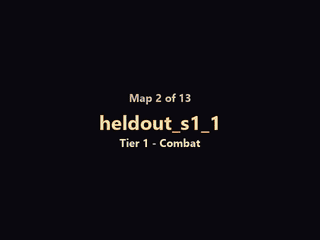
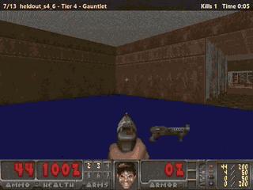
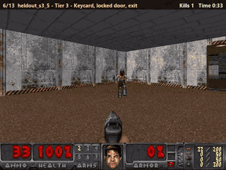
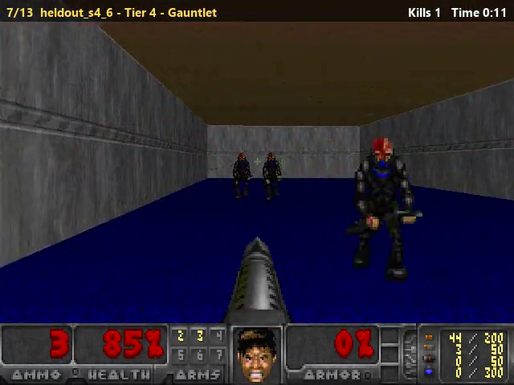
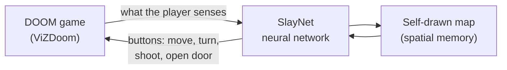
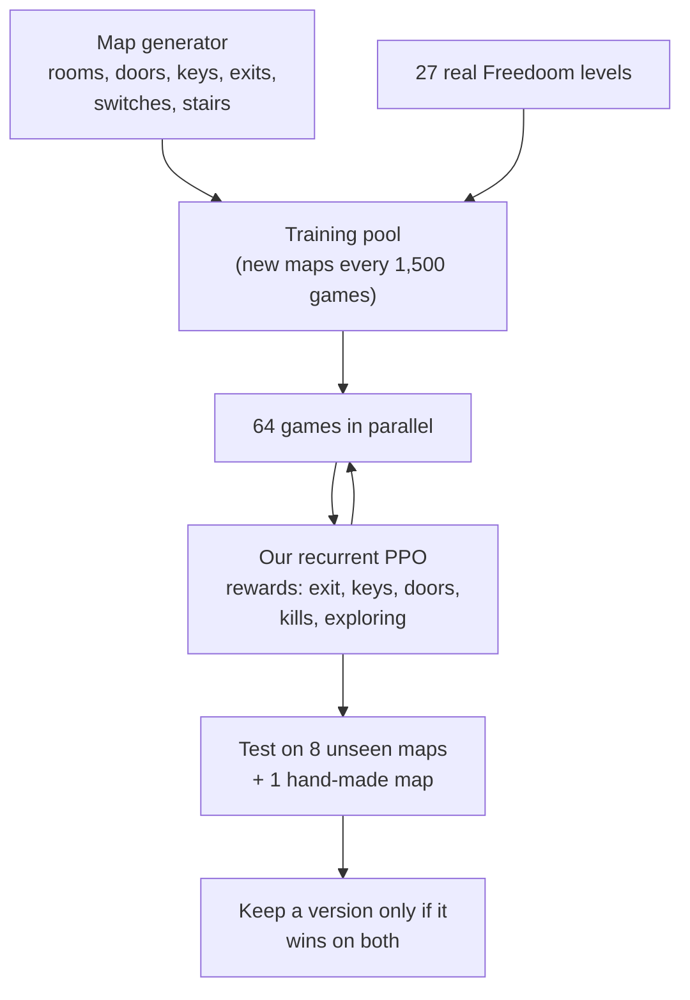
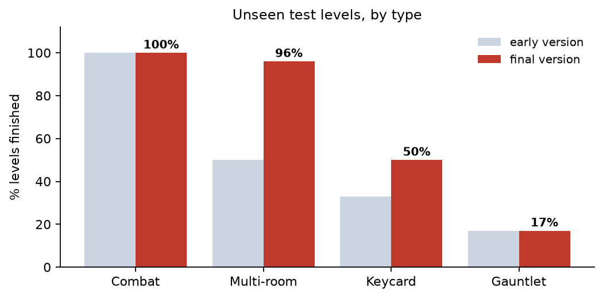
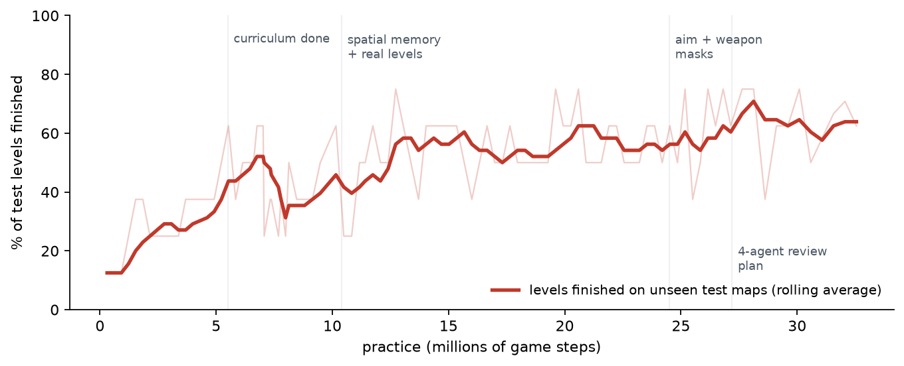

<div align="center">

# DoomSlay

### A neural network that learned to play DOOM by itself

**Team Slay** · Yugaantar 2026 DevForge · Track 1: *"Can It Play DOOM?"*


<table>
<tr>
<td align="center"><br><sub><b>Combat level:</b> 4 kills, exit in 8 seconds</sub></td>
<td align="center"><br><sub><b>Gauntlet level:</b> shotgun fight against a group</sub></td>
</tr>
</table>

*Real gameplay of the final agent on maps it has never seen, replayed with the normal DOOM screen.*

</div>

---

## At a glance

| | |
|---|---|
| **What it is** | An AI agent that plays DOOM from what the player "senses", with no map and no cheats |
| **How it learned** | Reinforcement learning (our own recurrent PPO) on thousands of generated maps plus real Freedoom levels |
| **Unseen test levels finished** | **66%** overall (96 games): combat **100%**, multi-room **96%**, keycard **50%**, gauntlet **17%** |
| **Hand-made template map** | **16 / 16** runs finished |
| **Fighting** | **3.3 kills per level**, **0%** of shots fired at empty air |
| **Speed** | about **2 ms** per decision (limit: 40 ms), 1 CPU core, no GPU needed |
| **Rules** | Every action comes from the trained network: no scripts, no pathfinding, no aimbot |

## Contents

1. [Watch it play](#watch-it-play)
2. [How it works (simple version)](#how-it-works-simple-version)
3. [Results](#results)
4. [What makes it different](#what-makes-it-different)
5. [Tech stack](#tech-stack)
6. [Quick start](#quick-start)
7. [Rules checklist](#rules-checklist)
8. [What we tried that did not work](#what-we-tried-that-did-not-work)
9. [Limitations and next steps](#limitations-and-next-steps)
10. [Repository layout](#repository-layout)

---

## Watch it play

<table>
<tr>
<td align="center"><br><sub><b>Keycard level:</b> has the key, walks to the exit</sub></td>
<td align="center"><br><sub><b>Hand-made map:</b> opens the door, clears the room</sub></td>
</tr>
<tr>
<td align="center"><br><sub>Three soldiers ahead, shotgun ready</sub></td>
<td align="center"><br><sub>Firing at two charging demons</sub></td>
</tr>
</table>

**Full video:** `uv run python -m training.make_video` records the agent on all 13 test maps and joins them
into one MP4 with the real DOOM status bar (health, armor, ammo, keys) plus a score panel. You can also watch it
live in a window with `uv run python -m training.watch`.

---

## How it works (simple version)



### 1. What the AI sees

The AI does **not** look at the screen pixels and never gets the real map. Every step it receives:

* **64 distance "feelers"** all around it (like a bat): how far the nearest wall, door, locked door, monster or item is in each direction.
* **A list of visible things**: up to 32 monsters and items in view, with distance, direction and movement.
* **Its own status**: health, armor, ammo, which keys it holds, and its speed.

### 2. The brain


* **Ray encoder:** a small convolution over the 64 feelers. It wraps around 360°, so "behind me" works correctly.
* **Monster/item encoder:** handles any number of visible things (0 to 32) with an attention layer, so it can focus on the most dangerous monster.
* **Memory (GRU):** remembers the last few seconds, for example "I just saw a locked door".
* **Output:** 6 small decisions every step (move, sidestep, turn, shoot, use, switch weapon) that become the 9 game buttons.

### 3. Spatial memory: the AI draws its own map

The rules give the AI no map, so it **builds one itself**. It tracks its own position from its speed and its own
turn presses (DOOM turns at a fixed rate), and marks on a small grid where it has walked and where its feelers saw
walls, doors and locked doors. A 21 x 21 piece of this map, centred on the AI, is fed back into the network every step.
This answers "have I been here already?" and "where was that locked door?".

<table>
<tr>
<td align="center"><br><sub>Keycard level: key (star), then exit</sub></td>
<td align="center"><br><sub>Multi-room level: finds the exit</sub></td>
<td align="center"><br><sub>Gauntlet: key and 9 kills</sub></td>
</tr>
</table>

*Top-down routes, drawn only for this README. The agent never sees these.*

### 4. Smart button rules (action masking)

Watching replays showed the AI shooting at empty air and switching weapons until it held its fist. We added
**action masks**, which the competition rules explicitly allow (masking from observation fields). They only block
pointless buttons; the network still makes every decision:

* **Shoot** only when a monster is near the crosshair, and tap instead of holding (holding the pistol spreads shots).
* **Switch weapon** only when stuck on the fist and ammo is available.
* **Use / open** only when a door, switch or wall is within reach.


### 5. How it learned



* **Maps:** a generator builds endless random levels in 4 types (combat, multi-room, keycard + locked door, gauntlet),
  with optional exit switches and stairs. 27 real Freedoom levels add hand-made shapes. 4 more real levels and
  8 generated levels are kept aside **only for testing**.
* **Curriculum:** easy levels first, harder ones as it improves.
* **Rewards:** points for reaching the exit (bonus for speed and health), keycards, doors, kills, damage dealt and
  exploring new areas; small penalties for taking damage, dying, wasting ammo and getting stuck.
* **Algorithm:** our own recurrent PPO (actor-critic with GRU memory), written from scratch in PyTorch.

---

## Results

<table>
<tr>
<td></td>
<td>

**Final version, unseen test levels (96 games)**

| Level type | Finished |
|---|---|
| Combat | **100%** |
| Multi-room | **96%** |
| Keycard → locked door → exit | **50%** |
| Gauntlet | **17%** |
| **All levels** | **66%** |
| Hand-made `two_rooms` map | **16 / 16** |
| Kills per level | **3.3** |
| Deaths per level | **0.12** |

</td>
</tr>
</table>

### Progress during training



| Version | Levels finished | Score* | Deaths / level | What changed |
|---|---|---|---|---|
| Untrained network | 0% | 8.6 | n/a | random weights |
| Update 1800 | 50% | 44.0 | 0.42 | 4-stage curriculum |
| Update 2800 | 54% | 46.4 | 0.29 | spatial memory + real levels |
| Update 3000 | 56% | 52.3 | 0.22 | aim shaping |
| Update 4240 | 51% | 54.2 | 0.15 | crosshair + weapon masks (3x more kills) |
| **Update 4800 (submitted)** | **66%** | **59.5** | **0.12** | training focused on the scored level types |

<sub>*Our estimate of the official score (exit, keys, doors, exploring, kills), weighted by level type. Each row is
6 to 12 repeated runs on all 8 test maps. Raw results are in [docs/results/](docs/results/).</sub>

### How we chose the final version

A 4-agent review (training, inference, compute and a skeptic) set a strict rule: a new version replaces the
submission only if it clearly wins on the unseen test levels **and** on the hand-made map. This blocked several
"better looking" versions that scored up to 63 on generated maps but failed the hand-made map (0 to 5 out of 8).

---

## What makes it different

* **Spatial memory without a map:** the agent draws its own occupancy map from its own movement and sensors.
* **Handles any number of monsters:** attention pooling over a variable-length list of visible things.
* **Map generator + real levels:** thousands of fresh levels so it cannot memorise layouts, plus real Freedoom geometry.
* **Learned aiming:** a policy-invariant aim reward and crosshair masking taught it to turn and aim by itself.
* **Honest model selection:** fair repeated tests, a hand-made map check and replay inspection instead of one lucky score.
* **Tiny and fast:** 1.0 M weights, about 2 ms per decision on one CPU core.

---

## Tech stack

| Area | Tools |
|---|---|
| Language | Python 3.13 |
| Game engine | ViZDoom 1.3.3, Freedoom 2 (official `doom_env` wrapper) |
| Neural network and RL | PyTorch 2.15 (our own recurrent PPO, attention, GRU, CNN) |
| Environment API | Gymnasium, NumPy |
| Maps | Own UDMF map generator, real Freedoom levels |
| Training speed | 64 parallel game processes (Python multiprocessing), CPU actor + GPU learner |
| Logging and charts | TensorBoard, Matplotlib |
| Videos | ImageIO + FFmpeg (gameplay MP4 and GIFs) |
| Brief PDF | ReportLab |
| Packaging | uv, Git LFS for the weights |
| Hardware used | One laptop: Intel i7-14700HX, RTX 5060 Laptop GPU, 16 GB RAM |

---

## Quick start

```bash
# 1. Install (Python 3.13 via uv)
uv sync

# 2. Official submission check
uv run python validate.py

# 3. Watch the agent play the 8 test levels live (Space = pause, N = next, Esc = quit)
uv run python -m training.watch

# 4. Play a generated level yourself (W A S D, mouse, click = shoot, E = use)
uv run python -m training.play_human --stage 3
```

**Train, test and make videos**

```bash
uv run python -m training.realmaps                       # build real-level training copies
uv run python -m training.train --run demo --stage 1 --num-envs 64 --mask-level 3   # train
uv run python -m training.compare submission/weights.pt --seeds 11,22,33        # fair test
uv run python -m training.inspect_play --ckpt submission/weights.pt --tag check # replays + stats
uv run python -m training.make_video                     # one MP4 of all 13 test maps
uv run python -m training.make_figures                   # README / brief charts
uv run pytest -q tests/test_slay.py tests/test_mapgen.py tests/test_bc.py tests/test_env.py
```

Use the agent from Python:

```python
from doom_env import make_env
from submission.agent import DoomAgent

env = make_env("maps/two_rooms.wad")
agent = DoomAgent(env.observation_space, env.action_space, "cpu")
obs, _ = env.reset(seed=0); agent.reset()
done = False
while not done:
    obs, r, term, trunc, info = env.step(agent.act(obs)); done = term or trunc
print(info)   # {'tic': ..., 'exit_reached': True}
```

---

## Rules checklist

| Rule | Status |
|---|---|
| Decisions come from trained neural weights | ✅ masks only remove options; no if/else action trees |
| No A* / Dijkstra / pathfinding, no atan2 aimbot | ✅ the agent never turns or aims for itself by rule |
| Own RL, not default Stable-Baselines3 | ✅ [training/ppo.py](training/ppo.py) written from scratch |
| Entry point `submission/agent.py` with `DoomAgent` | ✅ `__init__`, `reset`, `act` |
| 1 CPU thread, 2 GB VRAM, 8 GB RAM, 40 ms per decision | ✅ CPU only, about 2 ms per decision |
| Weights through Git LFS, repo under 1 GB | ✅ `submission/weights.pt` (4 MB), repo under 25 MB |
| Inference only uses `submission/` files | ✅ no imports from `training/` |
| Only the given observations | ✅ the self-drawn map uses only observations and the agent's own actions |
| `validate.py` passes | ✅ exit reached on the test map, about 2 ms per step |

---

## What we tried that did not work

| Idea | Result |
|---|---|
| Behavioural cloning from our scripted solver, then PPO | Exits dropped from 14/24 to 4/24: the solver moves very differently (no sidestepping, waits at doors) |
| Ensemble of two good versions | Inherited the weaker version's habit and failed the hand-made map |
| Lower randomness when choosing actions | Agent got stuck in loops more often |
| Adding masks to an agent trained without them | Score fell from 53.2 to 46.5: masks must be learned with |

Everything above is still in the repo ([training/bc_collect.py](training/bc_collect.py),
[training/bc_train.py](training/bc_train.py), [training/make_variant.py](training/make_variant.py)) so judges
can see the experiments.

---

## Limitations and next steps

* **Gauntlet levels (17%)** are the weakest: crowds of monsters plus long routes within a 2 minute limit.
* **Keycard levels (50%)**: it usually finds the key, but sometimes runs out of time before the exit.
* Full-size Freedoom campaign levels (70 to 200+ monsters) are not solved; they are much larger than a 2 minute test map.
* The self-drawn map slowly drifts on long levels (it stays correct locally).
* Next: longer training, curiosity rewards (RND), and imitation learning with a teacher that matches the agent's style.

---

## Repository layout

```
submission/        the evaluated agent
  agent.py           DoomAgent: observation -> buttons
  model.py           SlayNet network + action masks
  spatial_memory.py  self-drawn map (dead reckoning + rays)
  slay_obs.py        observation packing
  weights.pt         trained weights (Git LFS)
training/          everything used to train and test it
  train.py, trainer.py, ppo.py, envs.py, rewards.py, curriculum.py
  mapgen.py, realmaps.py              map generator and real levels
  eval.py, compare.py, select_candidate.py, inspect_play.py
  watch.py, play_human.py, record.py, make_video.py, make_figures.py, make_brief.py
maps/              held-out test maps (generated + real) and the template map
docs/              official rules, our condensed spec, results, media, dev log
tests/             unit tests (model, memory, masks, PPO, rewards, map generator)
brief.pdf          2-page project brief
```

<div align="center">

**Team Slay** · built during Yugaantar 2026 DevForge

</div>
