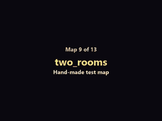
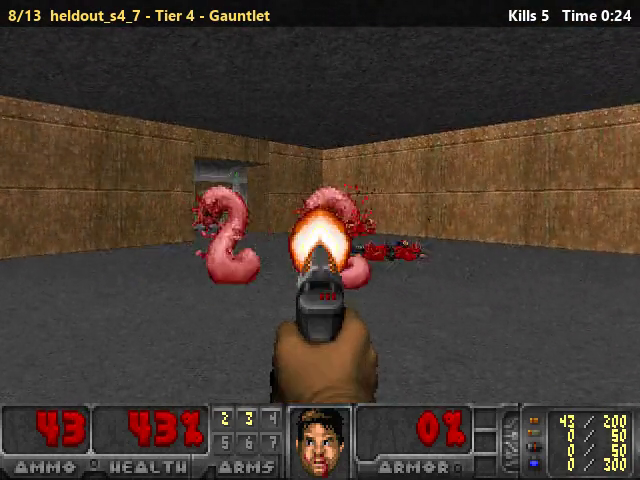
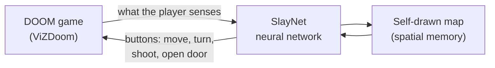
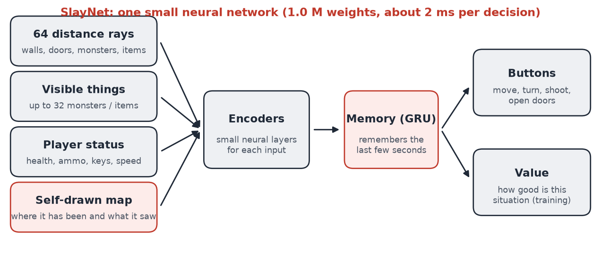
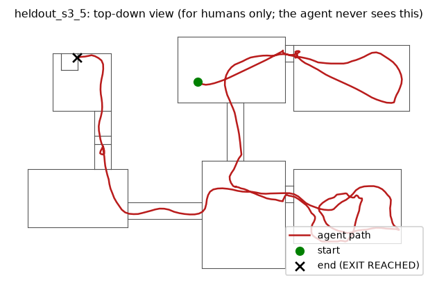
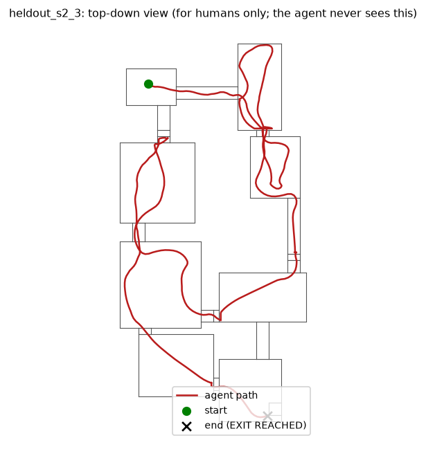
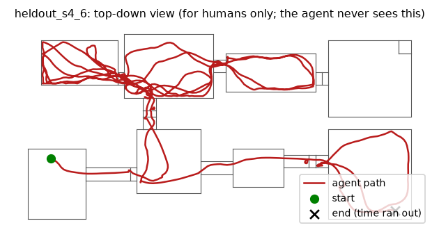
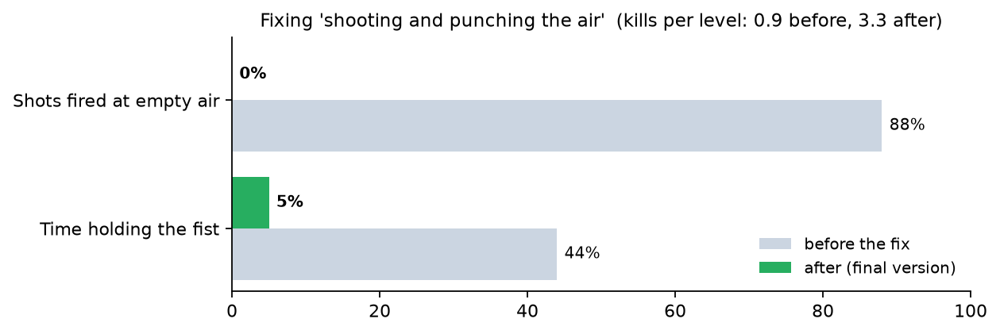

<div align="center">

# DoomSlay

### A neural network that taught itself to play DOOM

**Team Slay** · Yugaantar 2026 DevForge · Track 1: *"Can It Play DOOM?"*


<table>
<tr>
<td align="center"><br><sub><b>Combat level:</b> 4 kills, exit in 8 seconds</sub></td>
<td align="center"><br><sub><b>Gauntlet level:</b> shotgun fight against a group</sub></td>
</tr>
</table>

*Real gameplay of the final agent on maps it has never seen.*

</div>

---

## At a glance

| | |
|---|---|
| **What it is** | An AI that plays DOOM from what the player senses, with no map and no cheats |
| **Unseen levels finished** | **66%** overall: combat **100%**, multi-room **96%**, keycard **50%**, gauntlet **17%** |
| **Template map** | **16 / 16** runs finished |
| **Fighting** | **3.3 kills per level**, **0%** of shots fired at empty air |
| **Speed** | about **2 ms** per decision (limit 40 ms), 1 CPU core, no GPU needed |
| **Rules** | Every action comes from the trained network: no scripts, no pathfinding, no aimbot |

---

## Watch it play

<table>
<tr>
<td align="center"><br><sub><b>Keycard level:</b> has the key, walks to the exit</sub></td>
<td align="center"><br><sub><b>Template map:</b> opens the door, clears the room</sub></td>
</tr>
<tr>
<td align="center"><br><sub>Three soldiers ahead, shotgun ready</sub></td>
<td align="center"><br><sub>Firing at two charging demons</sub></td>
</tr>
</table>

---

## Results

<table>
<tr>
<td></td>
<td>

**Final agent on unseen test levels**

| Level type | Finished |
|---|---|
| Combat | **100%** |
| Multi-room | **96%** |
| Keycard → locked door → exit | **50%** |
| Gauntlet | **17%** |
| **All levels** | **66%** |
| Template map `two_rooms` | **16 / 16** |
| Kills per level | **3.3** |
| Deaths per level | **0.12** |

</td>
</tr>
</table>


| Stage | Levels finished | Score* | Deaths / level |
|---|---|---|---|
| Untrained network | 0% | 8.6 | n/a |
| After curriculum | 50% | 44.0 | 0.42 |
| + spatial memory and real levels | 54% | 46.4 | 0.29 |
| + aim training | 56% | 52.3 | 0.22 |
| **Final agent (submitted)** | **66%** | **59.5** | **0.12** |

<sub>*Our estimate of the official score (exit, keys, doors, exploring, kills), averaged over repeated runs on 8 unseen test maps.</sub>

---

## How it works



### What the AI sees

The AI does **not** look at screen pixels and never gets the real map. Every step it receives:

* **64 distance "feelers"** all around it: how far the nearest wall, door, locked door, monster or item is in each direction.
* **Visible things**: up to 32 monsters and items in view, with distance, direction and movement.
* **Its own status**: health, armor, ammo, keys held and speed.

### The brain



* **Ray encoder:** a convolution over the 64 feelers that wraps around 360°, so "behind me" works correctly.
* **Monster and item encoder:** an attention layer over any number of visible things, so it focuses on the biggest threat.
* **Memory (GRU):** remembers the last few seconds, for example "I just saw a locked door".
* **Output:** 6 decisions every step (move, sidestep, turn, shoot, use, switch weapon) that become the 9 game buttons.

### Spatial memory: the AI draws its own map

The AI gets no map, so it **builds one itself**. It tracks its own position from its speed and turns, and marks on a
grid where it has walked and where it saw walls, doors and locked doors. A 21 x 21 window of this map, centred on the
AI, goes back into the network every step. This answers "have I been here?" and "where was that locked door?".

<table>
<tr>
<td align="center"><br><sub>Keycard level: key (star), then exit</sub></td>
<td align="center"><br><sub>Multi-room level: finds the exit</sub></td>
<td align="center"><br><sub>Gauntlet: key and 9 kills</sub></td>
</tr>
</table>

<sub>Top-down routes drawn for this page only. The agent never sees them.</sub>

### Smart button rules

Action masks built from the observation (allowed by the contract) remove pointless buttons. The network still makes every decision:

* **Shoot** only when a monster is near the crosshair, as short taps.
* **Switch weapon** only when stuck on the fist with ammo available.
* **Use / open** only when a door or switch is within reach.



### How it learned

* **Practice levels:** our own map generator builds endless random levels (combat, multi-room, keycard + locked door,
  gauntlet) with doors, keys, exit switches and stairs, plus real Freedoom levels. Test levels are never used for practice.
* **Curriculum:** easy levels first, harder ones as it improves.
* **Rewards:** points for the exit (more when fast and healthy), keycards, doors and kills; small penalties
  for damage, dying and wasted ammo.
* **Exploring without getting stuck:** a bonus for every new area reached (count-based novelty), and a penalty plus a
  restart when it makes no progress for about 6 seconds, so it learns not to loop or freeze.
* **Algorithm:** our own recurrent PPO written from scratch in PyTorch, with 64 games running in parallel.

---

## Tech stack

| Area | Tools |
|---|---|
| Language | Python 3.13 |
| Game engine | ViZDoom 1.3.3, Freedoom 2, official `doom_env` wrapper |
| Neural network and RL | PyTorch 2.15: own recurrent PPO, attention, GRU, CNN |
| Environment API | Gymnasium, NumPy |
| Maps | Own UDMF map generator, real Freedoom levels |
| Training | 64 parallel game processes, CPU actor + GPU learner, TensorBoard |
| Media | Matplotlib, ImageIO + FFmpeg |
| Packaging | uv, Git LFS for the weights |

---

## Quick start

```bash
uv sync                                        # install
uv run python validate.py                      # official submission check
uv run python -m training.watch                # watch the agent play live (Space pause, N next, Esc quit)
uv run python -m training.play_human --stage 3 # play a generated level yourself
```

```python
from doom_env import make_env
from submission.agent import DoomAgent

env = make_env("maps/two_rooms.wad")
agent = DoomAgent(env.observation_space, env.action_space, "cpu")
obs, _ = env.reset(seed=0); agent.reset()
done = False
while not done:
    obs, r, term, trunc, info = env.step(agent.act(obs)); done = term or trunc
print(info)   # {'tic': ..., 'exit_reached': True}
```

---

## Rules checklist

| Rule | Status |
|---|---|
| Decisions come from trained neural weights | ✅ masks only remove options; no if/else action trees |
| No pathfinding, no aimbot | ✅ the agent never turns or aims by rule |
| Own RL, not default Stable-Baselines3 | ✅ [training/ppo.py](training/ppo.py) written from scratch |
| Entry point `submission/agent.py` | ✅ `DoomAgent` with `__init__`, `reset`, `act` |
| 1 CPU thread, 2 GB VRAM, 8 GB RAM, 40 ms per decision | ✅ CPU only, about 2 ms per decision |
| Weights through Git LFS, repo under 1 GB | ✅ `submission/weights.pt` (4 MB) |
| Only the given observations | ✅ the self-drawn map uses only observations and the agent's own actions |
| `validate.py` passes | ✅ |

---

## Next steps

* Gauntlet levels (crowds of monsters on long routes) are the hardest; more training there is the next goal.
* Curiosity rewards for faster exploration of large, real campaign levels.

<div align="center">

**Team Slay** · Yugaantar 2026 DevForge

</div>
